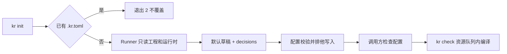

# #47 初始化与内嵌配置说明验收

日期：2026-10-16。分支：`bulai0408/kr-47-init`。
实现提交：`9cf8159`；同步 main 的合并提交：`7737218`。
最新集成基线：`origin/main` 的 `3c34a68`，包含 #43（PR #48）和 #46（PR #50）。

## 行为



- 普通工程/workspace：回放 `xcodebuild -list -json` 和 `-showBuildSettings -json`。
- XcodeGen：只读 `xcodegen dump`，保留后续生成命令；尊重 scheme 的测试 configuration。
- SwiftPM：只读 `swift package dump-package`，生成 `swift test` 命令套件；没有测试则生成 `swift build`。
- 多 App scheme、多 UI target、没有 UI 测试和待配置的隔离策略列入 `decisions`。
  通过编辑 `.kr.toml` 处理，不调用只接受已保存运行判断点的 `kr decide`。
- 运行时必须已安装、可用、支持设备类型且不低于部署目标；没有兼容项不写文件。
- macOS UI 测试生成 `destination = "macos"` 的 smoke 测试套件，不寻找 macOS 模拟器。
- 判断点只保留 target 名称，不复制可能含路径、签名资料或凭证的 build settings。
- 缺配置提示包括 `kr init` 和 `kr skill --reference config`，不再指向仓库示例目录。
  #43 合入后仅修改 `pool.rs` 的这处提示，保留其指定设备选择逻辑。

## 机器判定

| 检查 | #43 基线后的首轮 | 合入 #46 后 |
| --- | --- | --- |
| `cargo fmt --check` | PASS | PASS |
| `cargo clippy --all-targets -- -D warnings` | PASS | PASS |
| `cargo test` | 435/435 PASS | 436/436 PASS |
| `python3 -m unittest discover -s scripts -p test_release.py -v` | 不适用 | 16/16 PASS |

首轮三项通过后提交实现；再次 `git fetch && git merge origin/main`，
保留 README 的项目接入与发版章节，并在合并状态重跑三项。
未运行 Apple 完整门禁。Rust 中用环境变量启用的真实服务/设备集成分支未启用，
不能用 cargo 的通过数代替这些分支的真实验收。

发版脚本对实际最终二进制执行 `command_check`：

```text
PASS: tap README commands match this binary; pending = []
```

`packaging/homebrew-tap/README.md` 的 `kr init --json` 和
`kr skill --reference config` 与实现一致。既有脚本在命令可用时自动返回空 pending，
因此没有修改 release.py、test_release.py 或 tap README，也没有放宽原断言。

## 新增测试

主接缝为 `kr` CLI，使用 assert_cmd、KR_REPLAY 和 insta。
`syn` 仅为测试依赖，用于读取真正的 Deserialize 定义；这比序列化一个示例更严格，
不会漏掉新增的可选字段或 `skip_serializing_if` 字段。运行时 TOML 写出使用已有 workspace 的 toml 依赖。

`crates/kr/tests/init.rs`（11 项）：

- `init_reads_an_xcode_project_and_generates_a_valid_minimal_config_without_building`
- `init_never_overwrites_an_existing_config`
- `init_reads_xcodegen_without_generating_or_building_the_project`
- `init_accepts_a_standalone_swift_package_without_a_simulator`
- `init_reports_multiple_app_schemes_and_ui_targets_with_evidence_and_defaults`
- `commands_without_a_project_explain_init_and_the_embedded_config_reference`
- `init_reads_an_xcode_workspace_and_keeps_the_workspace_path`
- `init_does_not_write_a_config_when_installed_runtimes_are_older_than_the_deployment_target`
- `init_uses_a_macos_test_suite_for_native_ui_tests_without_inventing_a_runtime`
- `init_does_not_expose_private_build_settings_in_decision_evidence`
- `init_respects_the_xcodegen_schemes_test_configuration`

`crates/kr/tests/config_reference.rs`（2 项）：

- `the_embedded_config_reference_documents_every_configuration_field`
- `the_complete_commented_examples_load_through_kr_config`

已有 skill 测试现在要求第 0 步与 config reference；主文长度上限只增加新增第 0 步的一行。
帮助快照增加 init 命令。录制来源和脱敏方式见 `tests/fixtures/init/README.md`。
覆盖了已有文件、纯 XcodeGen、纯 SwiftPM、缺配置提示、部署目标、macOS、
敏感设置和自定义 configuration 的 RED→GREEN；多 scheme/target 的结构化输出另有快照。

## sample 真跑

在 `tests/sample` 的临时副本删除原 `.kr.toml`，使用本分支的二进制：

```sh
kr init --json
kr check --json
```

生成 [最小配置](evidence/issue-47/generated.kr.toml)，
[init JSON](evidence/issue-47/init.json) 的 `ok = true`，
[check JSON](evidence/issue-47/check.json) 的 `ok = true`、3/3 步骤 PASS：

| 步骤 | 结果 | 用时 |
| --- | --- | --- |
| generate | PASS | 120 ms |
| build build-for-testing KrSample (generic/platform=iOS Simulator) | PASS | 14,233 ms |
| filters | PASS | 39 ms |

`kr check` 自己申请 build 槽位并等待既有全机锁，没有外加锁、状态目录隔离或容量覆盖。
init 没有生成工程、构建或租设备；check 仅用 generic simulator destination，
没有启动模拟器，也没有创建或删除任何项目池设备。没有池设备需要保留或清理。
最终合并二进制又初始化一份新的 sample 临时副本，生成文件与上述真跑配置逐字一致；
没有因相同配置再次重复真实构建。

证据里的日志路径统一替换为 `<state>`。真实运行 ID 为
`01a14288-66a7-7476-b6d3-b2386a1cfb49`，可在本机 kr 的运行记录查原始日志。
验收临时目录与产物已移到工作树外，未提交 Xcode 工程、构建产物或本机路径。

## 需要人判断的手感

0 项：没有 App UI 改动。

## 未验证

- 没有执行 sample 的测试用例，只完成真实编译和过滤检查。
- UI 数据隔离仍需接入项目确认合成 bundle id 与允许的 entitlements；init 不会把正式 ID 当成允许名单。
- 其他工程、workspace、SwiftPM、macOS 的分支是 CLI 回放证据，未逐一真实编译。
- 没有验证真机、真实服务、Homebrew 安装、release 二进制打包或公开发布。
- 不合并本 PR，合入决定由协调者负责。
